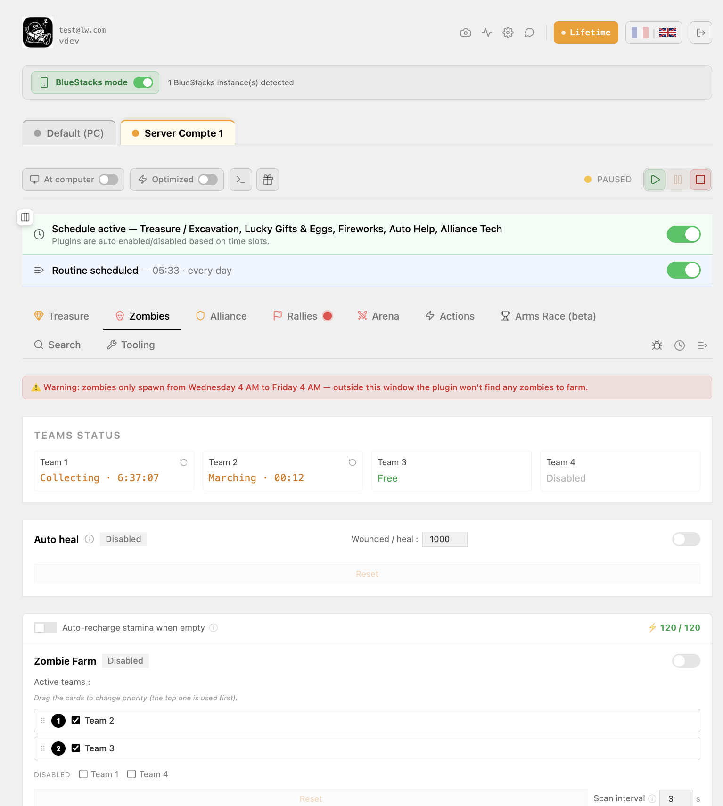
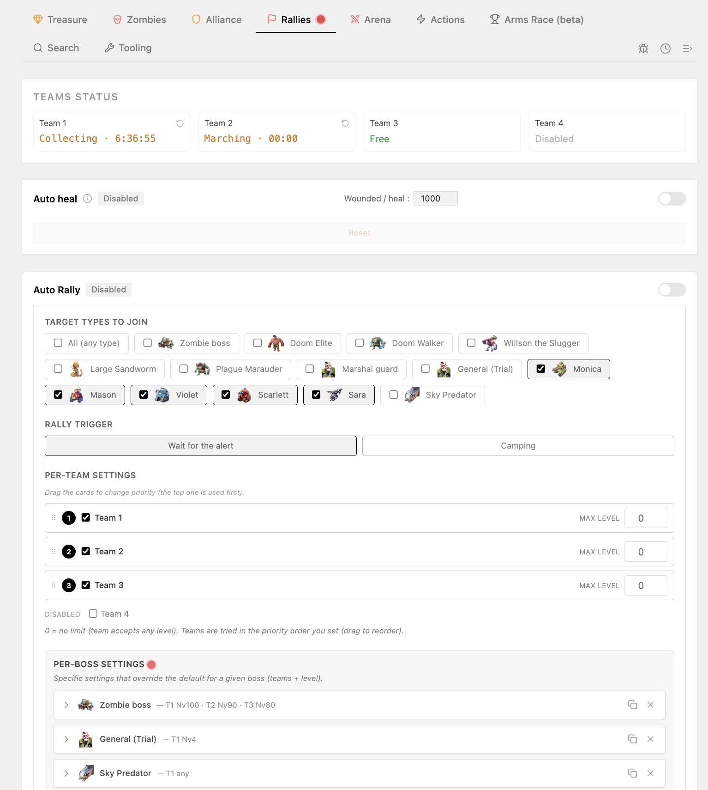
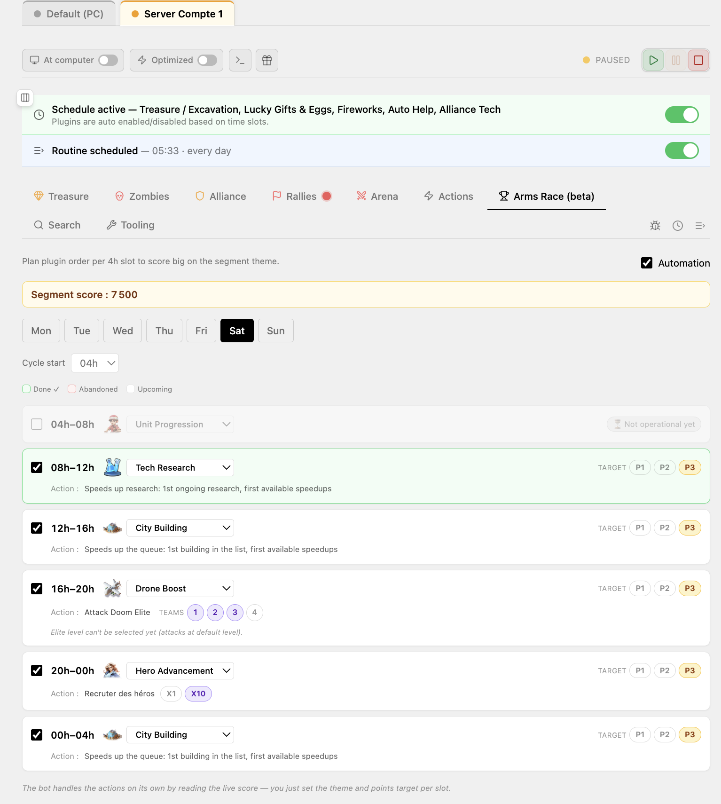
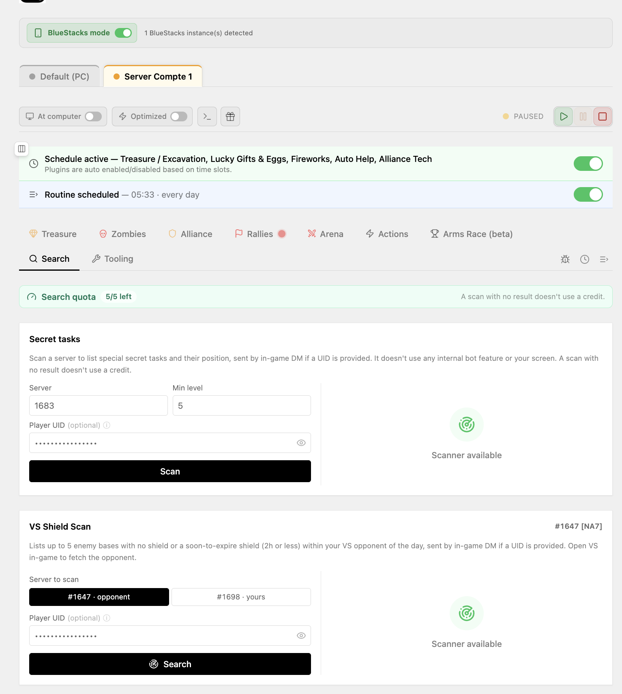
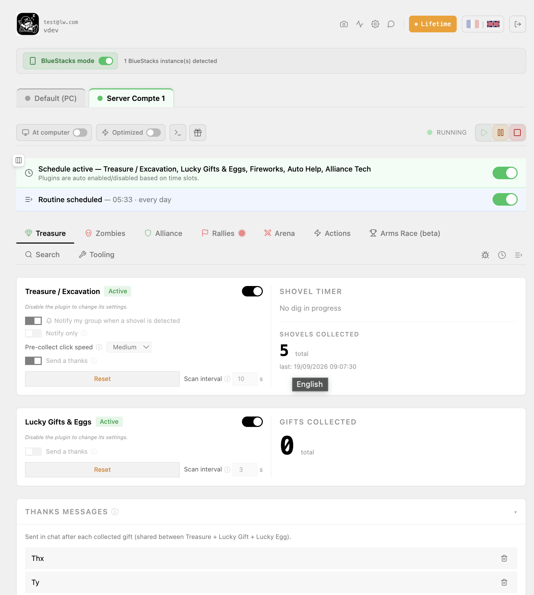
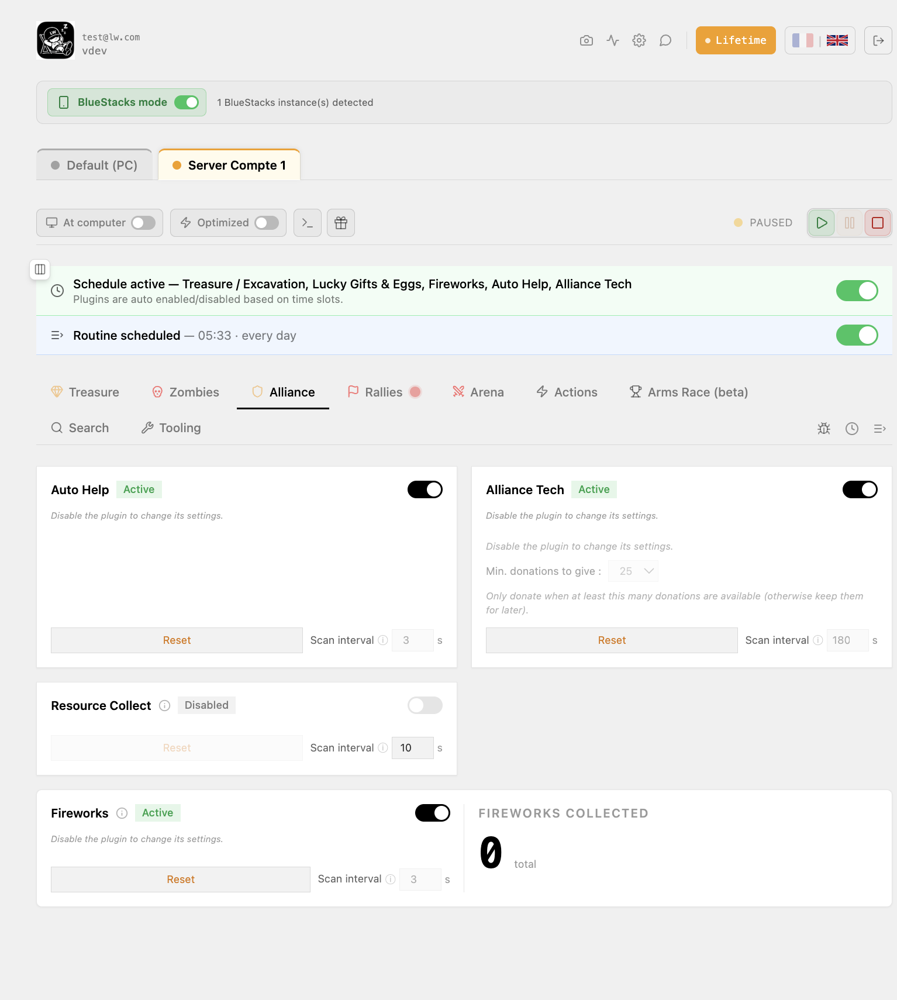
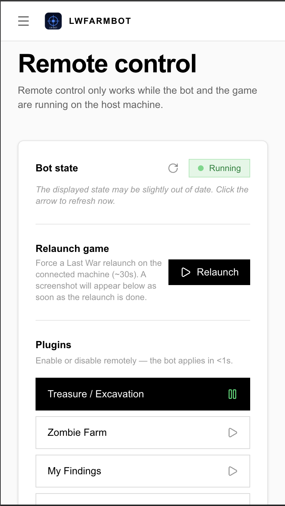

<picture>
  <source media="(prefers-color-scheme: dark)" srcset="https://lwfarmbot.com/logo-inverted.png">
  
</picture>

### The automation assistant for **Last War: Survival**

Farm zombies, hunt bosses, run the arena and your full daily routine — **24/7**, from a clean browser dashboard on your computer or phone.

## 🎮 What is LwFarmBot?

**LwFarmBot** is an **external, passive** automation assistant for **Last War: Survival**. It plays the repetitive parts of the game for you — so your account keeps growing while you sleep, work, or play something else. Everything is controlled from a **clean browser dashboard** (computer or phone): enable the features you want, set their schedules, and watch the activity, logs and rewards roll in.

> ℹ️ This repository is the public showcase for LwFarmBot. The app is a licensed product — **[download it and start a free trial (no credit card)](https://lwfarmbot.com/en/signup)**.

## ✨ Features

| | |
|---|---|
| 🧟 **Zombie farming** | Sends teams to zombies by level, manages marches and safe returns, handles stamina refills. |
| 👹 **Boss hunt** | Targets boss zombies by level, launches attacks and manages marches automatically. |
| 💎 **Treasure & gifts** | Detects treasures and gifts on the map or in chat and collects them automatically. |
| ⚔️ **Arena** | Automates 3v3 matches and Storm Arena — opponent selection, back-to-back battles, rank climbing. |
| 🛡️ **Auto shield** | Applies protection shields (8h / 12h / 24h) from inventory, on demand or on a schedule. |
| 🤝 **Alliance & routine** | Alliance help & tech, secret-task assistance, hero recruitment, arms race, full daily routine. |
| 📱 **Remote control** | Manage plugins and schedules, view logs and rewards from your browser (PWA) — computer or phone. |
| ⏰ **Scheduling** | Run each feature on time slots; the bot starts and stops itself at the hours you set. |

## 🖼️ Screenshots

<table>
  <tr>
    <td></td>
    <td></td>
  </tr>
  <tr>
    <td></td>
    <td></td>
  </tr>
  <tr>
    <td></td>
    <td></td>
  </tr>
</table>

 

<b>Remote control</b> — pilot the bot from your phone (PWA).

## 🛡️ Is it safe? Will it get my account banned?

LwFarmBot is **external and passive**: it only acts on the **game window** with **randomized, human-like clicks**. It **never**:

- ❌ injects code into the game
- ❌ reads or writes the game's memory
- ❌ modifies game files
- ❌ accesses your account or logs in for you
- ❌ routes gameplay through any third-party server

Those *internal* manipulations are what get accounts banned — LwFarmBot does none of them. No automation is 100% risk-free, which is why the bot mimics human behavior and **you stay in control of the schedule** (time slots, shields).

📖 **[Read the full guide → Is a Last War bot safe?](https://lwfarmbot.com/en/guides/bot-last-war-ban)**

## 💻 Platforms

- **Windows** and **macOS** — native
- **Android emulators** (BlueStacks / MuMu) via ADB, including multi-instance

## 🚀 Get started

1. **[Download](https://lwfarmbot.com/en/downloads)** the installer for Windows or macOS
2. **[Start the free trial](https://lwfarmbot.com/en/signup)** — no credit card required
3. Open the **browser dashboard**, enable the features you want, and set their schedules

## 📚 Guides

- [Best Last War bot — what to look for](https://lwfarmbot.com/en/guides/meilleur-bot-last-war)
- [Is a Last War bot safe / ban risk](https://lwfarmbot.com/en/guides/bot-last-war-ban)
- [Automatic zombie farming](https://lwfarmbot.com/en/guides/farm-zombies-automatique)
- [Farming overnight](https://lwfarmbot.com/en/guides/farmer-la-nuit)
- [Automating the arena](https://lwfarmbot.com/en/guides/automatiser-arene)
- [Install on Mac & Windows](https://lwfarmbot.com/en/guides/installer-bot-last-war-mac-windows)
- [Running the bot on an emulator](https://lwfarmbot.com/en/guides/bot-last-war-emulateur)

## 🔗 Links

**[🌐 Website](https://lwfarmbot.com)** · **[✨ Free trial](https://lwfarmbot.com/en/signup)** · **[⬇ Download](https://lwfarmbot.com/en/downloads)** · **[💬 Discord](https://discord.gg/mePRyUkJVt)** · **[▶️ YouTube](https://www.youtube.com/@lwfarmbot)**

Also available in French at <a href="https://lwfarmbot.com/fr">lwfarmbot.com/fr</a>

---

LwFarmBot is a third-party automation assistant and is not affiliated with or endorsed by the publisher of Last War: Survival. "Last War: Survival" is a trademark of its respective owner.
